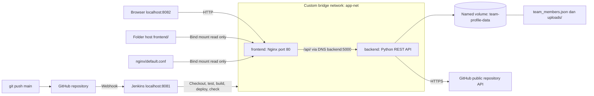

# Team Profile Showcase

Proyek UTS Cloud Computing Telkom University, studi kasus **10: Portofolio & Profil Kelompok**. Aplikasi menggunakan Python standard library, HTML/CSS/Vanilla JavaScript, Nginx, Docker Compose, dan pipeline Jenkins.

| Anggota | NIM |
| --- | --- |
| Lovind Luthfan Hakeem Firdaus | 101012330245 |
| Haifa Mohammad Adam | 101012330060 |
| Ibrahim Abdul Halim | 101012300384 |

## Arsitektur



Backend tidak mengekspos port langsung ke host. Browser mengakses `/api/` di Nginx; Nginx meneruskan request ke service `backend` melalui DNS Docker. File JSON dan foto tersimpan di named volume. Frontend memakai bind mount sehingga perubahan HTML/CSS/JS tidak memerlukan rebuild.

## Menjalankan dengan Docker

Prasyarat: Git, Docker Desktop dalam mode Linux containers, dan Docker Compose v2 yang mendukung `up --wait`. Aktifkan Docker Desktop dan pastikan `docker info` berhasil dari terminal lokal. Jenkins pada laptop ini memakai port **8081**, sedangkan aplikasi memakai **8082**.

```powershell
git clone https://github.com/Llovind/Team_Portfolio.git
cd Team_Portfolio
docker info
docker compose config --quiet
docker compose up -d --build --wait --wait-timeout 120
docker compose ps
```

Untuk checkout yang sudah ada, cukup masuk ke folder repository. Hentikan preview Python di port 8082 dengan Ctrl+C sebelum menjalankan Compose. Buka **http://localhost:8082**. Bila port lain diperlukan, salin `.env.example` menjadi `.env`, ubah `FRONTEND_PORT`, lalu jalankan Compose kembali. Jangan commit `.env`.

```powershell
docker compose logs --tail=80 backend frontend
docker compose down
```

`down` biasa mempertahankan named volume. Jangan memakai `down --volumes` pada stack utama bila data profil masih diperlukan. Data preview Python di `tmp/preview-data` terpisah dari named volume Docker; profil preview tidak otomatis dipindahkan.

## Fitur dan API

- Daftar anggota, lihat/edit profil, hard/soft skills, bio dan kontak.
- Kegiatan/project manual beserta foto; repositori publik GitHub dan tiga repo terbaru pada showcase.
- Loading, empty/error state, retry, dan proteksi stale edit menggunakan `_version`/`If-Match`.

| Metode | Path backend | Fungsi |
| --- | --- | --- |
| GET | `/members` | Daftar anggota dan versi data |
| POST | `/members` | Tambah anggota |
| PUT | `/members?index=X` | Ganti profil, NIM tidak boleh berubah |
| DELETE | `/members?index=X` | Hapus anggota |
| POST | `/uploads` | Unggah JPEG/PNG/WebP, maksimal 5 MiB |
| GET | `/uploads/<filename>` | Ambil foto |
| GET | `/github/repos?username=NAME&page=1` | Repo publik, pagination dan cache |
| GET | `/health` | Status API dan keterbacaan storage |

Melalui browser/host, tambahkan prefix `/api`, misalnya `http://localhost:8082/api/members`. PUT/DELETE juga menerima `?nim=X`; frontend menggunakan NIM dan header `If-Match` agar index yang bergeser tidak mengubah profil lain. Detail kontrak: [APPLICATION.md](docs/APPLICATION.md).

## Pengujian

Dengan Python 3.12+ dan Node.js 18+ pada host:

```powershell
python -B -m unittest discover -s tests -v
node --test tests/frontend.test.cjs tests/github_frontend.test.cjs
```

Uji Docker berikut membuat stack sementara dengan nama container/network/volume acak dan port host otomatis. Stack utama dan datanya tidak digunakan. Skrip memeriksa Nginx/API, mount volume, custom bridge, live bind mount, serta profil dan foto setelah container backend dihapus dan dibuat ulang. Resource pengujian dibersihkan setelah selesai.

```powershell
python -B tools/verify_docker.py --github-username Llovind
```

Hasil aktual ditulis ke `artifacts/docker-verification.json`. Hilangkan `--github-username` untuk menguji Docker tanpa bergantung pada ketersediaan GitHub. Jangan menganggap konfigurasi saja sebagai bukti bahwa persistence sudah diuji.

Health check yang sama dengan pipeline, dari jaringan Compose:

```powershell
Get-Content -Raw tools/check_deployment.py | docker compose exec -T backend python -
```

## Jenkins dan pengumpulan

Ikuti [JENKINS.md](docs/JENKINS.md) untuk agent, credentials, Pipeline from SCM, dan GitHub Webhook. Jenkinsfile memiliki tepat lima stage: **Checkout, Syntax Check, Build Image, Automated Deployment, Health Check**.

Panduan rekaman dan bukti penilaian ada di [DEMO.md](docs/DEMO.md). URL video demo: **belum direkam/ditambahkan**. Repository pengumpulan: https://github.com/Llovind/Team_Portfolio.

Status verifikasi: **17 tes backend/release dan 15 tes frontend lulus**. Uji Docker dari PowerShell lokal berhasil, termasuk Nginx/API, named volume, custom bridge, bind mount, persistence profil/foto setelah backend dihapus dan dibuat ulang, serta fetch GitHub sungguhan. Resource uji dibersihkan dengan exit code 0. Ringkasan bukti: [VERIFICATION.md](docs/VERIFICATION.md).

Jenkinsfile dan panduan webhook sudah disiapkan; pipeline Jenkins dan webhook **belum dijalankan/diaktifkan**. Video demo juga belum direkam. Environment agent tidak dapat mengakses socket Docker atau push GitHub; pengujian Docker di atas dijalankan lewat PowerShell lokal pengguna.
